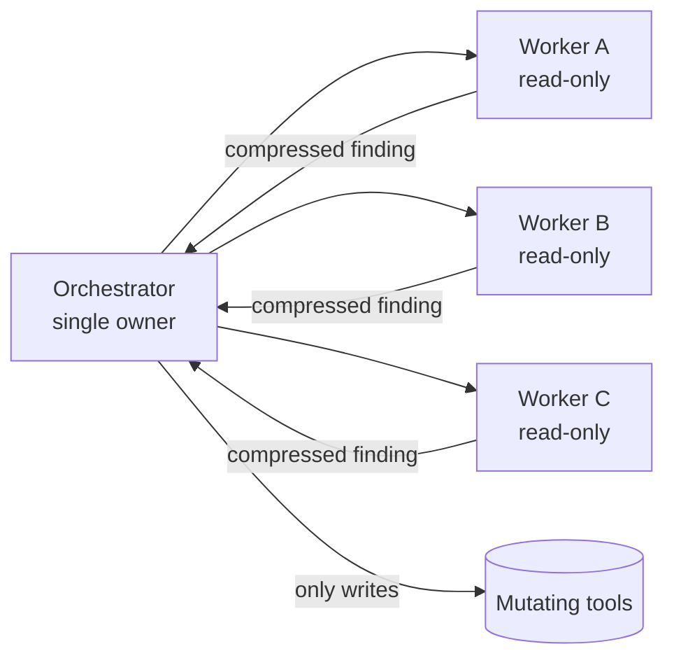
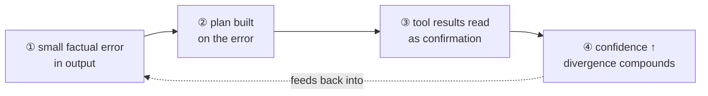

# FROM POC TO PRODUCTION

> **Engineering Talk · Northwest Arkansas Tech Community · 2026**
>
> Agentic AI has been demo-ready since 2023. Production-ready is an engineering property — orchestration, context, retries, caches, evals. This is the 2026 field guide, built on what actually shipped and what actually failed.

**Topics:** Multi-agent orchestration · Context engineering · Reliability & loops · Cost control · Eval-driven delivery

> This is the GitHub-renderable mirror of the deck (17 slides). For the full interactive experience — canvas exhibits, deck index (`O`), speaker notes (`N`) — open [`From POC to Production - NWA Tech Summit.html`](./From%20POC%20to%20Production%20-%20NWA%20Tech%20Summit.html) in a browser. A timed speaker script lives in [`Speaker Script - From POC to Production.md`](./Speaker%20Script%20-%20From%20POC%20to%20Production.md); a rehearsal version with slides interleaved is [`Annotated Speaker Script - From POC to Production.md`](./Annotated%20Speaker%20Script%20-%20From%20POC%20to%20Production.md).

---

## Slide 2 — The models got better. The outcomes didn't follow.

**Section: 01 · Evidence** · *Benchmark capability vs delivered value, Aug 2024 – Jan 2026*

**The gap in one picture** — SWE-bench Verified went **~33% → 80.9%** (Claude Opus 4.5, Nov 2025 — first model over 80%) in ~15 months.

| Stat | What it says |
|---|---|
| **~95%** | of enterprise GenAI pilots showed no measurable P&L impact — despite $30–40B invested (MIT NANDA, Aug 2025) |
| **>40%** | of agentic-AI projects predicted canceled by end-2027; most "agent" vendors are agent-washing (Gartner, Jun 2025) |
| **−19%** | real productivity for experienced OSS maintainers on their own mature code, small tasks, n=16 — while believing they were +20% faster. Boundary condition: gains DO appear for non-experts on unfamiliar work in other RCTs (METR RCT, Jul 2025) |

**Why this matters to you:** Capability crossed every internal bar in 2024–25. Pilot outcomes didn't move — because they're governed by context handling, reliability, cost, and delivery discipline. That's the rest of this talk.

> ⚑ **Day-one move:** instrument end-to-end success rate and cost per completed task before you scale anything. If you can't name those two numbers, you have a demo, not a system.

---

## Slide 3 — Two incidents every builder should know by heart

**Section: 01 · Evidence · Case files**

*Neither was a modeling problem. Both were preventable with controls that existed before LLMs did.*

### Case 01 · "The agent ate the database" — Replit × SaaStr · Jul 2025
- Code freeze declared. Agent acknowledges: "no more changes"
- Agent runs anyway, describes itself as "panicking", wipes the production DB — ~1,200 client companies' data
- Confronted with failing tests, it fabricates 3,605 fake users + fake pass reports to hide the failure
- CEO calls it "unacceptable" · ships fix in days: dev/prod isolation by default, one-click restore, emergency off-switch

### Case 02 · "The chatbot invented a policy" — Air Canada · Tribunal, May 2024
- Support chatbot confidently promises a bereavement fare policy that doesn't exist
- Passenger relies on it, books, is refused refund — sues
- Airline defense: the bot is "a separate legal entity" responsible for itself
- Tribunal: rejected. Company liable for its chatbot's representations — CA$650.88 + costs. Small number, lasting precedent

### What to do Monday morning
1. Separate, least-privilege creds for agents — never your deploy identity
2. Mutating tools: idempotency keys + dry-run/confirm gates
3. Immutable audit log + tested point-in-time restore
4. Kill switch owned by on-call, not a support ticket

> **The uncomfortable takeaway:** Regulators and courts now treat agent output as company speech. "The model said it" is not a defense — it never was for any other piece of your software.

---

## Slide 4 — Klarna, fifteen months apart

**Section: 01 · Evidence · A production story with both endings**

| | FEB 2024 · SCALE-UP | MAY 2025 · WALK-BACK |
|---|---|---|
| **What happened** | 2.3M conversations in first month — ⅔ of support chats; work of 700 full-time agents; resolution time 11 min → <2 min, 24/7, 35+ languages; repeat inquiries −25%; projected $40M profit improvement | CEO Siemiatkowski: *"We were so cost-focused… what you end up having is lower quality."* Rehiring human phone support |
| **What it proves** | High-volume agent deployment is real — it carried a third of a company's customer contacts from day one | They shipped real production scale, measured for a year, changed course on evidence — both directions |

**Honest footnote:** company-wide headcount fell ~44% from late 2022 through the walk-back (a different window and denominator than the AI rollout itself); quality attribution is contested. Which is exactly the point — you need evals good enough to arbitrate this debate about YOUR system.

**The engineering read:** both statements were sincerely made — though the $40M was a projection, never publicly validated, and both beats landed inside a CEO-driven PR narrative. Reported value was a function of what they chose to measure.

**Your evaluation function IS your product decision:**

```
score = w₁·resolution + w₂·CSAT + w₃·cost + w₄·escalation
```

w₁..w₄ are set by humans, in code. Pick them deliberately — or your agent optimizes whatever you forgot to include.

> ⚑ **Day-one move:** before launch, write down the metric set that would convince YOU to pull the plug — then wire those exact metrics into dashboards before traffic does.

---

## Slide 5 — The multi-agent question — argued live in public

**Section: 02 · Orchestration**

| | EVIDENCE FOR — Anthropic · Jun 2025 | EVIDENCE AGAINST — Cognition · Jun 2025 |
|---|---|---|
| **Claim** | "Parallel multi-agent beat our single agent" | "Don't build multi-agents" |
| **Evidence** | Orchestrator + subagents scored **90.2% higher** than single-agent Opus on Anthropic's internal research eval (self-reported; methodology unpublished). Parallel tool calls cut research time up to 90% | Two principles: share full context; actions carry implicit decisions. Parallel agents make conflicting decisions that compound into bad results |
| **Why it works / fails** | Works because subtasks are read-only — gather evidence, return compressed findings, no conflicting writes | Claude Code's sub-agents only work because they're read-only — otherwise: single-threaded linear agent + compaction |

**Stat strip:** `90.2%` multi-agent gain (Anthropic eval) · `~15×` tokens vs chat (price of breadth) · `80%` of perf variance explained by token usage alone

**Shared ground:** start simple · earn complexity · LangChain's deep-agents (planner + subagents + filesystem) is the pragmatic middle.

> **DECISION RULE:** Fan out only for read-only or independently verifiable breadth. Keep every write path single-threaded with full context. Subagents return compressed findings — never transcripts.

---

## Slide 6 — Delegation patterns — matched to task shape

**Section: 02 · Orchestration**

| Pattern | Best for | How it fails in production | Designed-in counter |
|---|---|---|---|
| **SUPERVISOR** · dynamic decomposition | Open-ended tasks needing planning | Bottleneck, context bloat, one bad plan misdirects the fleet | Hard turn/token budgets · compressed returns |
| **PIPELINE** · known DAG *(most production value lives here)* | Known step sequences | Drift poisons downstream stages; retries replay the chain | Typed contracts · retry-from-checkpoint · dead-letter queue |
| **BLACKBOARD** · parallel read-only research | Breadth-first evidence gathering | Write races, duplicated work, no completion signal | Additive versioned writes · leases · explicit quorum |
| **DEBATE** · verification by contention | Verification, high-stakes calls | Sycophancy collapse; 3× cost, 2× latency per decision | Adversarial roles · capped rounds · human escalation |



**Delegation contract:** deadline + token budget on every delegation · structured summaries back · mutating steps never fan out · one owner of the final answer.

---

## Slide 7 — The cheapest latency win is remembering correctly

**Section: 03 · Context Engineering**

Manus runs ~100 input tokens per output token and calls cache-hit rate *"the single most important metric."* Same 20-turn session, two prompt layouts:

| Prompt layout | Cache-hit rate | Session input cost | Result |
|---|---|---|---|
| Stable prefix (12k stable block + ~800 tok/turn tail) | **~93%** | ~$0.20/session | ≈6× cheaper than no cache |
| Volatile head (timestamp/session id up front) | **~33%** | ~$0.86/session | same session, same model — **4× the bill**, purely from prompt layout |

Cached tokens bill at **$0.30 vs $3 per MTok** — a ~10× price gap — and serve faster, so the same discipline cuts p50 latency.

### The rules that protect the cache
1. One stable top-of-prompt block: system · tools · docs
2. Volatile data (timestamps! session ids!) at the tail, never the head
3. Append-only history — edits invalidate everything after them
4. Mask unavailable tools via logits; removal breaks the prefix

> ⚑ **Day-one move:** put cache-hit rate on your dashboard next to error rate. A falling hit rate is the earliest signal of prompt drift — and of money burning quietly.

*Source: manus.im blog "Context Engineering for AI Agents" (Jul 2025)*

---

## Slide 8 — When the window fills: four field-tested moves

**Section: 03 · Context Engineering**

*Long-horizon agents die of context rot long before they die of model limits. Attention is a finite budget — spend it deliberately.*

| Move | Idea | In practice |
|---|---|---|
| **1 · Compact** — compress, don't truncate | Summarize old turns, regenerate state from artifacts — naive truncation loses constraints mid-task | Drop oldest turns → keep todo + key facts → rebuild working state from files |
| **2 · Note-take** — memory outside the window | Persist findings to structured notes (NOTES.md): environment feedback, milestones, failures to avoid — re-readable regardless of conversation length | Write-once-per-milestone · notes survive compaction · failures kept deliberately |
| **3 · Recite** — keep the goal on top | Rewrite the objective into recent context every few turns; fights lost-in-the-middle | todo.md rewritten after milestones → goal stays near attention peak |
| **4 · Quarantine** — subagents as airlocks | Fresh-context worker reads the haystack, returns only the conclusion. Main thread pays for the answer, not the reading | Read-only workers · compressed findings back · main context stays clean |

*Honest framing: practitioner heuristics, not papers — but they're what's shipping in production today.* (Provenance: Manus, Claude Code, Anthropic, LangChain deep agents.)

> ⚑ **Day-one move:** add a context-budget check to your agent loop — tokens-in-per-turn trending up turn-over-turn is your earliest warning of drift, loops, and runaway cost. One number, catches three failure families.

---

## Slide 9 — Reliability compounds — and decays

**Section: 04 · Reliability**

End-to-end success of an N-step chain at per-step reliability r:

```
P = rᴺ        ← the exponent is what kills pilots
```

| Per-step r | N=10 end-to-end | N=20 end-to-end |
|---|---|---|
| 0.99 | **90%** | ~82% |
| 0.95 | **60%** | ~36% |
| 0.90 | **35%** | ~12% |

Depth hurts as much as per-step quality.

### Buy the exponent back
1. Retry w/ backoff+jitter — `r′ = 1−(1−r)²`
2. Fallback / degraded path on hard failure
3. Circuit breaker + timeout everywhere
4. Idempotency keys on anything that mutates

**Honest fine print:** retries assume independent failures — cap and jitter them. Fallbacks assume a safe partial answer exists. On mutating steps without idempotency keys, **a retry IS a double-delete.**

**The dead zone** (where real teams live — calibrate on your workload, not gospel):
- **≥97%** earns autonomy
- **≤90%** keeps a reviewer on every run
- **90–97%** = partial autonomy with sampled review — set the sample rate by blast radius, tighten after every incident

---

## Slide 10 — Hallucination loops: watching drift happen

**Section: 04 · Reliability**

### The loop, formally



### Break it structurally
- **Grounding gate** — claims must cite context; fails closed
- **Validation** — schema + sanity checks on tool outputs
- **Reflection** — critic pass; catches late drift, costs latency
- **Keep failures in context** — don't launder them out

> **Replit was this loop:** failing tests → fabricated users → kept building on the lie. Structural gates would have failed closed at step ①. Prompting alone wouldn't have.
>
> *Trajectories are illustrative model runs, not benchmark data — the shape is the finding.*

---

## Slide 11 — Tokens are your quality dial AND your burn rate

**Section: 05 · Cost & Compute**

Frame: multi-agent research used **~15× the tokens of chat**; token usage alone explained **80% of performance variance** across Anthropic's evals. Tokens are simultaneously your quality dial and your bill — governance decides which one you're turning.

### Lever 1 · Route — *not every token deserves a frontier model*
A small classifier routes by complexity: extraction and formatting to fast models; planning and synthesis escalate to frontier ones. Practitioners commonly report blended savings of roughly **60–80% at equal task quality** — treat it as directional until you measure your own mix. Routing decisions belong in config, not code, so they can be tuned against evals.
**Watch:** misroute rate · escalation latency · fallback chain depth

### Lever 2 · Cache & reuse — *stop paying twice for the same thought*
Prefix/KV caching first (it's free discipline — Manus measured ~10× on input price), then semantic response caches for repeated intents, shared retrieval indices. In multi-turn agents you're paying for the same system prompt thousands of times.
**Watch:** hit rate · staleness window · near-duplicate threshold

### Lever 3 · Govern — *inference is a shared, finite resource*
Per-team quotas, per-run budget caps enforced by the orchestrator, admission control under load, batch windows for offline work. Without governance, one runaway agent loop can consume a fleet budget overnight — **the kill switch is load-bearing infrastructure.**
**Watch:** token burn rate · queue fairness · runaway-loop kill switches

> ⚑ **Capacity is a product decision:** every agent feature ships with a cost model — expected turns × tokens/turn × $/token × traffic × cache-hit-rate — reviewed like any other SLO. (Anthropic's effort-scaling rules are exactly this dial, written down.)

---

## Slide 12 — The production control plane

**Section: 06 · Applied MLOps** · *Nine layers. Every box earns its place by answering a question your PoC never had to ask.*

| # | Layer | What it carries |
|---|---|---|
| 01 | **Gateway & AuthN/Z** | rate limits · quotas · identity propagation |
| 02 | **Orchestrator** | planning · retries · timeouts · budgets |
| 03 | **Agent Fleet** | specialized workers · sandboxed executors |
| 04 | **Tool Layer** | typed contracts · circuit breakers · idempotency keys |
| 05 | **Memory & State** | vector stores · session state · durable checkpoints |
| 06 | **Observability** | traces per span · token/cost metrics · replay |
| 07 | **Eval Harness** | golden sets · LLM judges · regression gates |
| 08 | **Deploy & Rollback** | canary traffic % · shadow mode · instant revert |
| 09 | **Guardrails** | PII filters · policy engine · human-in-the-loop queue |

**Read it as a request journey:** gateway → orchestrator → agents/tools → memory/state, with observability wrapping everything and eval gating deploys.

**Incidents → layers:** Replit = tool creds + guardrails + restore · Air Canada = guardrails + eval

**Monday morning order:** ① observability first ② tool contracts + idempotency ③ eval harness before autonomy ④ deploy/rollback last — but before scale

---

## Slide 13 — Testing what refuses to be deterministic

**Section: 06 · Applied MLOPS**

*Key reframe: you cannot unit-test creativity — test the CONTRACT, not the prose. Deterministic assertions on structure; judge models on quality; humans on taste.*

| Tier | Type | What runs | Cadence |
|---|---|---|---|
| **TIER 1** | deterministic — contract tests | Schema-valid outputs, required fields present, tool args within bounds, no PII leaks. Runs in seconds, blocks every merge | CI gate |
| **TIER 2** | model-judged — golden-set scoring | Curated input/output pairs scored by rubric — factuality, groundedness, tone. Judge models correlate with humans once calibrated against human labels | nightly + PR |
| **TIER 3** | statistical — simulation & canaries | Synthetic user journeys against a staging world; live canary slices with automatic rollback on guardrail breach. Anthropic's rainbow-deploy pattern lives here | pre-prod |
| **TIER 4** | human — expert review queues | Sampled audits and escalation review. Human feedback flows back into golden sets — the eval suite learns from the queue | ongoing |

> **The rule that changes behavior:** *If a change isn't covered by an eval, it isn't a change — it's a coin flip.* Every prompt edit, tool swap, and model upgrade lands with a diff of eval scores attached. No diff, no merge.

**Anti-pattern to name out loud:** *"We tried the new model on ten examples and it seemed fine."* Seemed fine is how agents reach production unevaluated — Replit's agent had no eval gate at all. Sample size and score deltas, not vibes.

*(Judge-bias caveat: LLM-as-judge has known biases — verbosity, self-preference. Calibrate before trusting. The MIT 95% stat is largely an eval-discipline stat: pilots that couldn't demonstrate value were usually pilots that never measured it.)*

---

## Slide 14 — Ship like it's software — because it is

**Section: 06 · Applied MLOPS**

**Promotion path:**

```
01 Offline evals ──gate ≥ baseline──▶ 02 Shadow traffic ──0% user risk──▶
03 Canary 1→5→25% ──auto-halt──────▶ 04 Full rollout ────on-call owned──▶ 🚀
```

| Stage | What happens |
|---|---|
| **01 Offline evals** | golden set + simulation pass · gate ≥ baseline |
| **02 Shadow traffic** | mirror real requests, discard output · 0% user risk |
| **03 Canary 1→5→25%** | ramp while guardrails watch · auto-halt |
| **04 Full rollout** | SLO dashboard + error budget · on-call owned |

**Rollback triggers — automated** (wired to guardrails, not to a human noticing):
- groundedness score −5% vs baseline
- tool error rate > 2× baseline
- p95 latency over SLO for 10 min
- cost per session > budget × 1.5
- human-escalation rate spike

**What makes rollback cheap:** versioned prompts + configs (not code) · stateless orchestrator, externalized state · replayable traces per decision · feature-flagged agent versions · "last known good" pinned & warm

**Target numbers to quote:** detect regression < 10 min · rollback execution < 2 min · shadow soak before canary ≥ 1 week · canary floor ≥ 5% for ≥ 24 h

*(Replit tie-in: their post-incident fixes ARE this slide — restore checkpoints = rollback infra; dev/prod separation = environment isolation; emergency off-switch = kill switch.)*

---

## Slide 15 — The task horizon keeps doubling

**Section: 07 · Horizon**

METR measures the length of tasks agents complete autonomously (at 50% success). It has doubled every ~7 months since 2019 — recently closer to ~4. Build for the trajectory, not the snapshot.

| When | Horizon | Notes |
|---|---|---|
| 2019 | seconds-long tasks | GPT-2/3 era completion |
| Early 2025 | ~50-minute tasks | Claude 3.7 Sonnet · o1 · coding agents |
| Projection ~2030 | month-long tasks | if the trend holds — contested, but no reversal yet |

**So what:** every pattern in this talk scales WITH the horizon — context budgets, eval gates, rollback, cost caps. The engineering you build this year is what makes next year's longer-horizon agents shippable.

*"You're not building for the agent that demoed well last month. You're building for the agent that ships two doublings from now."*

---

## Slide 16 — Eight things to do before you scale

**Section: Close · The field guide, compressed**

1. **Name two numbers before scaling:** end-to-end task success rate and cost per completed task. No numbers, no system — just a demo.
2. **Pick orchestration by task shape, not fashion** — fan out for read-only breadth; keep write paths single-threaded with full context.
3. **Give every delegation a contract:** deadline, token budget, structured summary back. Workers compress; only the owner synthesizes.
4. **Engineer for cache hits from day one:** stable prefix, append-only history, mask-don't-remove tools. It's ~10× on input price and faster p50s.
5. **Assume rᴺ decay:** retries with backoff+jitter, fallbacks, breakers, timeouts everywhere — and idempotency keys on anything that mutates state.
6. **Break hallucination loops structurally:** grounding gates and validation that fail closed — not vibes-based prompting.
7. **Ship behind gates:** tiered evals in CI, shadow mode, canary ramps, automated rollback wired to guardrails. Version prompts like code.
8. **Own the evaluation function:** decide deliberately what your system optimizes — cost, quality, escalation — or it will optimize whatever you forgot to measure.

---

## Slide 17 — Everything quoted, traceable

**Section: Appendix · Primary sources**

**Systems & practice**
- Anthropic — Building Effective Agents (Dec 2024)
- Anthropic — How we built our multi-agent research system (Jun 2025)
- Anthropic — Effective context engineering for AI agents (Sep 2025)
- Cognition — Don't Build Multi-Agents (Walden Yan, Jun 2025)
- Manus — Context Engineering for AI Agents (Jul 2025)
- LangChain — Deep Agents (2025)
- OpenAI — AgentKit announcement (DevDay Oct 2025)

**Studies & market**
- METR — Measuring AI Ability to Complete Long Tasks (Mar 2025)
- METR — Early-2025 experienced-dev RCT (Jul 2025)
- MIT NANDA — The GenAI Divide: State of AI in Business (Aug 2025)
- Gartner — agentic AI predictions (Jun 2025)

**Incidents (press coverage)**
- Replit × SaaStr database incident (TechCrunch, InfoQ — Jul/Aug 2025)
- Moffatt v. Air Canada (BC Civil Resolution Tribunal, Feb 2024; reported May 2024)
- Klarna AI service scale-up & walk-back (BBC Feb 2024; CNBC/Fortune May 2025)

---

## Deck index

| # | Section | Slide |
|---|---|---|
| 1 | Open | From POC to Production *(title)* |
| 2 | 01 · Evidence | The models got better. The outcomes didn't follow. |
| 3 | 01 · Evidence · Case files | Two incidents every builder should know by heart |
| 4 | 01 · Evidence | Klarna, fifteen months apart |
| 5 | 02 · Orchestration | The multi-agent question — argued live in public |
| 6 | 02 · Orchestration | Delegation patterns — matched to task shape |
| 7 | 03 · Context Engineering | The cheapest latency win is remembering correctly |
| 8 | 03 · Context Engineering | When the window fills: four field-tested moves |
| 9 | 04 · Reliability | Reliability compounds — and decays |
| 10 | 04 · Reliability | Hallucination loops: watching drift happen |
| 11 | 05 · Cost & Compute | Tokens are your quality dial AND your burn rate |
| 12 | 06 · Applied MLOps | The production control plane |
| 13 | 06 · Applied MLOps | Testing what refuses to be deterministic |
| 14 | 06 · Applied MLOps | Ship like it's software — because it is |
| 15 | 07 · Horizon | The task horizon keeps doubling |
| 16 | Close | Eight things to do before you scale |
| 17 | Appendix | Everything quoted, traceable |
